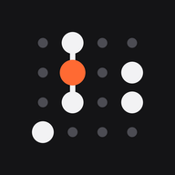

  

<h1 align="center">高科校園（試玩版）</h1>

  給高科大學生用的課表與作業截止 App，還在設計階段，這個網頁是<b>用於實踐程式 UI 的想像</b>。 
  <a href="https://ijioxc.github.io/nkust-campus-preview/"><b>打開試玩 →</b></a>

---

## 加到 iPhone 主畫面

1. 用 Safari 打開 [ijioxc.github.io/nkust-campus-preview](https://ijioxc.github.io/nkust-campus-preview/)
2. 點分享按鈕，選「加入主畫面」
3. 從主畫面的圖示打開，就是全螢幕的 App

## 現在的狀態

- 畫面裡的課表、作業、成績都是**假資料**（王小明），不是任何人的真實資料。
- 還不能登入學校系統，也還不能匯入自己的資料。
- 這不是學校官方的 App。

## 試玩時可以看什麼

| 頁 | 一個點代表 |
|---|---|
| 日 | 一節課 |
| 週 | 一節課，七天排成點陣課表 |
| 月 | 一天 |
| 年 | 一週，加上學分圓環 |

上下滑換頁，右下角的輪盤選課程。

## 資料放在哪

之後接上自己的資料時，資料只存在你自己的手機裡，不會上傳到這個網站或任何伺服器。

---

有問題或想法，歡迎開 Issue。
